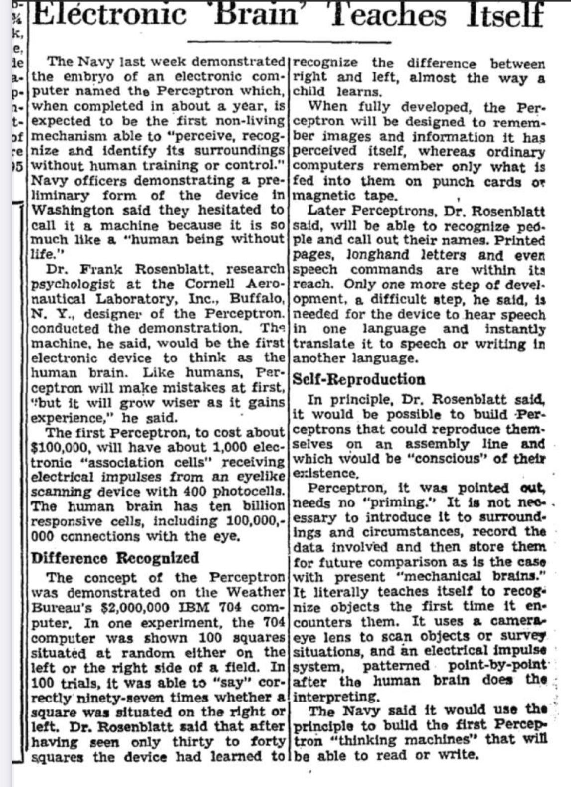

<!-- .slide: style="text-align: center;" -->
# AI Agents, Verification, and the Future of Research

 

### Cory Baird
Assistant Professor, University of Tokyo

 

Korea 2026

Note:
Welcome audience of policymakers, economists, and finance leaders.

---

## Overview: AI Agents, Verification and the Future of Research

AI supercharged has supercharge research and work output

How can we verify?

How can we trust?

Do we need new systems for work, education, and research?

Note:
Reveal each question sequentially.
Three core themes for today.

---

## Early AI Earthquake: Seoul 2016

<iframe width="100%" height="400" 
  src="https://www.youtube-nocookie.com/embed/8tq1C8spV_g?start=22" 
  title="AlphaGo Trailer" 
  frameborder="0" 
  allow="accelerometer; autoplay; clipboard-write; encrypted-media; gyroscope; picture-in-picture; web-share" 
  referrerpolicy="strict-origin-when-cross-origin" 
  allowfullscreen 
  style="border-radius: 6px; box-shadow: 0 4px 14px rgba(0,0,0,0.12);">
</iframe>

  <a href="https://www.youtube.com/watch?v=8tq1C8spV_g&t=22s" target="_blank" rel="noopener noreferrer">Link: AlphaGo Documentary Trailer</a>

<h3>AlphaGo vs. Lee Sedol</h3>
<ul>
  <li>DeepMind's AlphaGo defeated Go champion Lee Sedol in Seoul</li>
  <li>Proved power of "AI" (neural nets)</li>
</ul>

Note:
Anchor the talk in Korea's pivotal historical role in modern AI history.

---

## AI $\neq$ new technology

  <!-- Column 1: 1956 (Top) -->
  

    
AI term coined Symbolic foundations

    
Dartmouth

    
1956

  

  <!-- Column 2: 1982 (Bottom) -->
  

    
1982

    
Hopfield Net

    
Recurrent neural memory AI winter thaw

  

  <!-- Column 3: 1997 (Top) -->
  

    
Defeats chess champion Heuristic tree search

    
Deep Blue

    
1997

  

  <!-- Column 4: 2012 (Bottom) -->
  

    
2012

    
AlexNet

    
GPU deep learning boom ImageNet error halved

  

  <!-- Column 5: 2015 (Top) -->
  

    
Speech &amp; translation leap Multi-layer scaling

    
Deep Learning

    
2015

  

  <!-- Column 6: 2017 (Bottom) -->
  

    
2017

    
Transformer

    
Attention mechanisms Foundation for modern LLMs

  

  <!-- Column 7: 2022 (Top) -->
  

    
Generative foundation models Mass public adoption

    
ChatGPT

    
2022

  

  <!-- Central Axis & Nodes -->
  

  

  

  

  

  

  

  

Note:
Contextualize Seoul 2016 within seven decades of algorithmic progress
Generative systems build on long evolutionary trajectory

---

## 1936--Not a new question: Are machines intelligent?

<iframe width="100%" height="400" 
  src="https://www.youtube-nocookie.com/embed/lTMEUA6VnJE" 
  title="The Imitation Game Scene" 
  frameborder="0" 
  allow="accelerometer; autoplay; clipboard-write; encrypted-media; gyroscope; picture-in-picture; web-share" 
  referrerpolicy="strict-origin-when-cross-origin" 
  allowfullscreen 
  style="border-radius: 6px; box-shadow: 0 4px 14px rgba(0,0,0,0.12);">
</iframe>

  <a href="https://www.youtube.com/watch?v=lTMEUA6VnJE" target="_blank" rel="noopener noreferrer">Link: The Imitation Game (Interrogation Scene)</a>

<h3>Inventor of Computer, Alan Turing, questioned: Can machines think?</h3>
<ul>
  <li>"It is possible to invent a single machine which can be used to compute any computable sequence." (1936) </li>
  <li>"If a machine is expected to be infallible, it cannot also be intelligent." (1947)</li>
</ul>

Note:
Turing shifted question from biological essence to functional capability
Core benchmark for evaluating machine output

---

## 1958--Not a new question: Are machines intelligent?

  
  
New York Times (July 8, 1958)

<h3>An early version of AI (perceptron)</h3>
<ul>
  <li>Frank Rosenblatt invented perceptron</li>
  <li>Predicted it would be able to: "perceive, recognize and identify its surroundings"</li>
</ul>

Note:
Early perceptron demonstrations sparked massive media predictions
Parallels modern claims around emergent intelligence

---

## 2020s--Not a new question: Are machines intelligent?

  <iframe width="100%" height="420" 
    src="https://www.youtube-nocookie.com/embed/Hw7_f_NwmX0" 
    title="Dario Amodei (Anthropic)" 
    frameborder="0" 
    allow="accelerometer; autoplay; clipboard-write; encrypted-media; gyroscope; picture-in-picture; web-share" 
    referrerpolicy="strict-origin-when-cross-origin" 
    allowfullscreen 
    style="max-width: 250px; margin: 0 auto; display: block; border-radius: 6px; box-shadow: 0 4px 14px rgba(0,0,0,0.12);">
  </iframe>
  

    <a href="https://www.youtube.com/shorts/Hw7_f_NwmX0" target="_blank" rel="noopener noreferrer">Dario Amodei (Anthropic)</a>
  

  <iframe width="100%" height="420" 
    src="https://www.youtube-nocookie.com/embed/kPzeqQoshx4" 
    title="Sam Altman (OpenAI)" 
    frameborder="0" 
    allow="accelerometer; autoplay; clipboard-write; encrypted-media; gyroscope; picture-in-picture; web-share" 
    referrerpolicy="strict-origin-when-cross-origin" 
    allowfullscreen 
    style="max-width: 250px; margin: 0 auto; display: block; border-radius: 6px; box-shadow: 0 4px 14px rgba(0,0,0,0.12);">
  </iframe>
  

    <a href="https://www.youtube.com/shorts/kPzeqQoshx4" target="_blank" rel="noopener noreferrer">Sam Altman (OpenAI)</a>
  

  <iframe width="100%" height="420" 
    src="https://www.youtube-nocookie.com/embed/UktpwiM0MeI" 
    title="Demis Hassabis (Google DeepMind)" 
    frameborder="0" 
    allow="accelerometer; autoplay; clipboard-write; encrypted-media; gyroscope; picture-in-picture; web-share" 
    referrerpolicy="strict-origin-when-cross-origin" 
    allowfullscreen 
    style="max-width: 250px; margin: 0 auto; display: block; border-radius: 6px; box-shadow: 0 4px 14px rgba(0,0,0,0.12);">
  </iframe>
  

    <a href="https://www.youtube.com/shorts/UktpwiM0MeI" target="_blank" rel="noopener noreferrer">Demis Hassabis (DeepMind)</a>
  

Note:
Frontier lab leaders debate AGI timelines and machine capability
Recurring question on whether scale yields genuine intelligence

---

<!-- .slide: class="section-break-slide" -->
# Part 1: Demystifying Modern AI

### LLMs: Are they smart or are we dumb?

---

## The word "AI" = Zero Meaning

### The most important distinction: Generative vs. Predictive

<h3>Generative AI</h3>

Generating content

<ul>
  <li><strong>Mechanism:</strong> Model underlying data distributions to produce novel samples</li>
  <li><strong>Objectives:</strong> Text generation, summarization, conversational agents</li>
  <li><strong>Outputs:</strong> Natural language, source code, synthetic data</li>
  <li><strong>Examples:</strong> ChatGPT (text), Copilot (code completion)</li>
</ul>

<h3>Predictive AI</h3>

Answering a question

<ul>
  <li><strong>Mechanism:</strong> Analyze historical patterns to identify unknown values or categories</li>
  <li><strong>Objectives:</strong> Classification, numerical regression, anomaly detection</li>
  <li><strong>Outputs:</strong> Continuous values, probabilities, labels (Yes/No)</li>
  <li><strong>Examples:</strong> Revenue forecasts, fraud detection, risk scoring</li>
</ul>

---

## When people say AI today: Almost always = Generative
### Generative AI: Almost always = Transformers

<ul style="margin-bottom: 12px;">
  <li>Foundational architecture from landmark "Attention Is All You Need" paper (2017)</li>
  <li>All major models same share architecture</li>
</ul>

<iframe src="https://sebastianraschka.com/llm-architecture-gallery/#architecture-gallery" width="100%" height="410" frameborder="0" style="border: 1px solid var(--border-color); border-radius: 6px; box-shadow: 0 4px 14px rgba(0,0,0,0.12); pointer-events: auto;" allow="fullscreen"></iframe>

  <a href="https://sebastianraschka.com/llm-architecture-gallery/#architecture-gallery" target="_blank" rel="noopener noreferrer">Link: Sebastian Raschka's LLM Architecture Gallery</a>

Note:
Interactive gallery catalogs transformer architectural variants across frontier LLMs
All modern large models derive from the original 2017 attention mechanism

---

## Visualizing the Transformer

  <a href="https://ig.ft.com/generative-ai/" target="_blank" rel="noopener noreferrer" class="btn-action">
    Launch Live FT Visual Guide &rarr;
  </a>

<h3>Next-Token Mechanics</h3>
<ul>
  <li>Text mapped to high-dimensional token vectors</li>
  <li><strong>Self-Attention:</strong> Weighs relationships across prior context</li>
  <li>Predicts mathematically plausible continuations</li>
</ul>
<h3 style="margin-top: 20px;">Key Takeaway</h3>
<ul>
  <li>Pattern continuation without empirical ground truth</li>
  <li>Must be constrained when handling financial data</li>
</ul>

---

## Stochastic Parrots...???

<h3>LLMs: A Normal Technology</h3>

The Engineering Tool Perspective

<ul>
  <li><strong>Core Mechanism:</strong> Statistical next-token prediction over text distributions</li>
  <li><strong>Internal State:</strong> Surface linguistic correlations without grounded meaning</li>
  <li><strong>Failure Mode:</strong> Confident hallucinations and brittle multi-step reasoning</li>
  <li><strong>Practical Role:</strong> Useful cognitive artifact requiring strict verification harnesses</li>
</ul>

<h3>LLMs: A Machine God</h3>

The Superintelligence Perspective

<ul>
  <li><strong>Core Claim:</strong> Scale yields genuine emergent understanding and artificial general intelligence</li>
  <li><strong>Internal State:</strong> Autonomous reasoning entities forming beliefs and intentionality</li>
  <li><strong>Failure Mode:</strong> Anthropomorphic projection mistaking syntactic fluency for consciousness</li>
  <li><strong>Practical Risk:</strong> Uncritical delegation of policy and finance decisions to black-box models</li>
</ul>

Note:
Stochastic parrots debate pits statistical pattern matching against claims of emergent cognition
Reality in research: powerful workflow accelerator devoid of autonomous understanding

---

## Even "Dumb" AI Is Revolutionary

<strong>Utility Without AGI:</strong> Immense economic value does not require artificial general intelligence. Automating repetitive data plumbing transforms white-collar research.

<h3>What AI Accelerates</h3>
<ul>
  <li>Parsing messy unstructured regulatory filings</li>
  <li>Extracting sentiment from central bank transcripts</li>
  <li>Standardizing disparate cross-country data tables</li>
</ul>

<h3>The Strategic Division</h3>
<ul>
  <li><strong>Humans:</strong> Institutional reality checks and causal design</li>
  <li><strong>Agents:</strong> Rigidly constrained workflow acceleration</li>
</ul>

---

<!-- .slide: class="section-break-slide" -->
# Part 2: The Verification Crisis

### Has AI broken scientific validation, or just exposed it?

---

## The Generation vs Verification Asymmetry

"AI has collapsed the cost of doing certain kinds of work: coding, data construction, empirical analysis... the cost of verifying that the work is correct has moved much less." 
&mdash; Paul Goldsmith-Pinkham (Yale SOM)

<h3>Generation Cost: Zero</h3>
<ul>
  <li>Instant regression scripts and formatted exhibits</li>
  <li>Plausible narrative memos generated on demand</li>
  <li>Mathematical errors remain invisible to surface checks</li>
</ul>

<h3>Verification Cost: Constant</h3>
<ul>
  <li>Auditing complex merges requires deep domain expertise</li>
  <li>Human review cannot scale to thousands of machine runs</li>
  <li>Solution: Automate verification, not just drafting</li>
</ul>

---

## Did the Deficit Start with AI?

<h3>Pre-AI Economics Was Fragile</h3>
<ul>
  <li>Replication crises existed long before transformers</li>
  <li>Ad-hoc scripts lacking reproducible environments</li>
  <li>Inconsistent folder layouts and undocumented joins</li>
  <li>Fragile spreadsheets harboring silent calculation bugs</li>
</ul>

<h3>AI Removed the Volume Brake</h3>
<ul>
  <li>Human typing speed previously acted as a rate limiter</li>
  <li>Low volume kept the verification deficit hidden</li>
  <li>AI unleashed infinite volume without fixing auditing</li>
  <li><strong>Core Reality:</strong> Verification has always been the bottleneck</li>
</ul>

---

## Why Stakes Are High in Policy &amp; Finance

<h3>Central Banking</h3>
<ul>
  <li>Policy rates depend on exact inflation dynamics</li>
  <li>Date misalignment distorts monetary decisions</li>
  <li>Requires deterministic, auditable models</li>
</ul>

<h3>Public Finance</h3>
<ul>
  <li>Tax forecasts govern multi-billion national budgets</li>
  <li>Subtle parameter errors cause massive fiscal gaps</li>
  <li>Demands reproducible empirical evidence</li>
</ul>

<h3>Sovereign Risk</h3>
<ul>
  <li>Risk indices drive bond yields and capital flows</li>
  <li>Black-box scores trigger intellectual herding</li>
  <li>Regulators require verified data provenance</li>
</ul>

---

<!-- .slide: class="section-break-slide" -->
# Part 3: Infrastructure Over Prompts

### Hard constraints beat fragile prompt engineering

---

## The Prompting Trap

<h3>Prompts Are Fragile</h3>
<ul>
  <li>"Act as an econometrician" is non-deterministic</li>
  <li>Identical prompts generate different code across runs</li>
  <li>Checks rhetorical style, not mathematical logic</li>
  <li>Chat reviews reinforce the model's own biases</li>
</ul>

<h3>Errors Live in the Plumbing</h3>
<ul>
  <li>Real mistakes happen in low-level data plumbing:
    <ul>
      <li>Mismatched frequency resampling</li>
      <li>Silent dropping of balanced panel observations</li>
      <li>Unlogged variable transformations</li>
    </ul>
  </li>
  <li>Linguistic prompts cannot fix deterministic plumbing</li>
</ul>

---

## The Macro Agent Harness Concept

<strong>Harness Engineering:</strong> Replace unconstrained code drafting with rigid software contracts. Agents never write econometric engines from scratch; they modify declared YAML configs.

<h3>Unconstrained (Fragile)</h3>
<ul>
  <li>Writes bespoke scripts from scratch</li>
  <li>Executes ad-hoc transformations in memory</li>
  <li>Zero reproducibility guarantees</li>
</ul>

<h3>Harness-Constrained (Verifiable)</h3>
<ul>
  <li>Calls pre-built, tested domain libraries</li>
  <li>Modifies parameters within strict schemas</li>
  <li>Emits deterministic execution manifests</li>
</ul>

---

## The Open-Source Research Stack

<h3>1. Database: OpenMacro</h3>

11.4M observations across 150+ datasets. Harmonizes World Bank, IMF, BIS data across frequencies.

<h3>2. Econometrics: Stats Transformer</h3>

Declarative YAML pipelines. Estimators benchmarked against STATA, MATLAB, and R.

<h3>3. NLP: Auto-Econ Sentiment</h3>

Replaces black-box LLMs with auditable macro dictionaries and open transformer models.

<h3>4. Theory &amp; Pipeline: DSGE Runner</h3>

Industrial DSGE modeling 10x faster than Dynare with deterministic artifact caching.

---

<!-- .slide: class="section-break-slide" -->
# Part 4: Safe Agent Architecture

### Sandboxed, vendor-neutral, and tool-routed systems

---

## The Three Architecture Guardrails

<h3>1. Role Subagents</h3>
<ul>
  <li>Single agents suffer from self-validating hallucinations</li>
  <li>Separate into narrow roles:
    <ul>
      <li><strong>Data Agent:</strong> DB access only</li>
      <li><strong>Model Agent:</strong> Config only</li>
      <li><strong>Reviewer:</strong> Read-only</li>
    </ul>
  </li>
</ul>

<h3>2. Sandboxing</h3>
<ul>
  <li>General AI has dangerous filesystem access</li>
  <li>Enforce strict OS isolation:
    <ul>
      <li>Raw data mounted read-only</li>
      <li>Isolated scratch spaces</li>
      <li>Core code immutable</li>
    </ul>
  </li>
</ul>

<h3>3. Vendor Neutrality</h3>
<ul>
  <li>Proprietary lock-in creates major vulnerabilities:
    <ul>
      <li>Silent model drift</li>
      <li>Pricing monopoly</li>
      <li>Intellectual herding</li>
    </ul>
  </li>
  <li>Modular harness supporting open weights</li>
</ul>

---

## Single Agent vs Multi-Agent Harness

<h3>Vulnerable: Single Agent</h3>
<pre class="diagram-box">
     [User Request]
            │
            ▼
┌───────────────────────────┐
│    Unbounded General AI   │
│  - Writes code            │
│  - Downloads data         │
│  - Audits own output      │
└───────────────────────────┘
            │
            ▼
[High Hallucination Risk]
[Data Overwrite Exposure]
</pre>

<h3>Robust: Multi-Agent Harness</h3>
<pre class="diagram-box">
         [User Request]
                │
                ▼
      [Orchestrator Agent]
      ┌─────────┴─────────┐
      ▼                   ▼
[Data Agent]        [Model Agent]
(OpenMacro DB)     (Stats Engine)
      │                   │
      └─────────┬─────────┘
                ▼
        [Reviewer Agent]
        (Read-Only Audit)
</pre>

---

## The Golden Rule: Read-Only Data

<strong>First Rule of Research MLOps:</strong> Never allow an AI agent write-access to raw data. Raw observational data must remain an immutable foundation.

<h3>Common Silent Failures</h3>
<ul>
  <li>Agent silently drops outliers without logging</li>
  <li>Column headers overwritten during merges</li>
  <li>Temporary patches lost when container exits</li>
</ul>

<h3>The Sandbox Protection</h3>
<ul>
  <li><strong>Read-Only Mounts:</strong> OS blocks modifications</li>
  <li><strong>Scratch Folders:</strong> Isolated intermediate storage</li>
  <li><strong>Cryptographic Hashes:</strong> Bitwise verification</li>
</ul>

---

<!-- .slide: class="section-break-slide" -->
# Part 5: The Future of Research

### Essential human skills and policy autonomy

---

## Human Capital in the Agentic Era

<h3>Skills Depreciating</h3>
<ul>
  <li>Memorizing coding syntax and commands</li>
  <li>Manual spreadsheet data entry</li>
  <li>Boilerplate slide and document formatting</li>
  <li>Basic literature search without context</li>
</ul>

<h3>Skills Appreciating</h3>
<ul>
  <li><strong>Data Literacy:</strong> Evaluating provenance and bias</li>
  <li><strong>Causal Identification:</strong> Designing clean empirical tests</li>
  <li><strong>Domain Reality Checks:</strong> Catching subtle institutional errors</li>
  <li><strong>Cross-Disciplinary Translation:</strong> Framing policy decisions</li>
</ul>

---

## Sovereign AI &amp; Policy Autonomy

<h3>The Concentration Risk</h3>
<ul>
  <li>Frontier models concentrated in the US and China</li>
  <li>Closed APIs carry commercial and political vulnerability</li>
  <li>Vendors silently alter weights without notice</li>
</ul>

<h3>The Open Science Imperative</h3>
<ul>
  <li>Central banks and treasuries require auditable foundations</li>
  <li>Deploying open weights preserves institutional confidentiality</li>
  <li>Public policy must remain independently verifiable</li>
</ul>

---

## Core Takeaways

<strong>Strategic Summary:</strong> AI does not have to cause a verification crisis. Replace conversational prompting with verified domain harnesses to gain massive efficiency while safeguarding rigor.

<h3>1. Build the Harness</h3>

Invest in deterministic domain libraries, typed schemas, and automated validation.

<h3>2. Isolate &amp; Sandbox</h3>

Enforce role separation and protect raw observational data with read-only mounts.

<h3>3. Elevate Human Judgment</h3>

Shift human expertise toward data provenance, causal design, and policy trade-offs.

---

<!-- .slide: style="text-align: center;" -->
# Thank You

### Questions &amp; Discussion

**Cory Baird**  
Assistant Professor, Markets + Governance, University of Tokyo  
[baird@g.ecc.u-tokyo.ac.jp](mailto:baird@g.ecc.u-tokyo.ac.jp)
